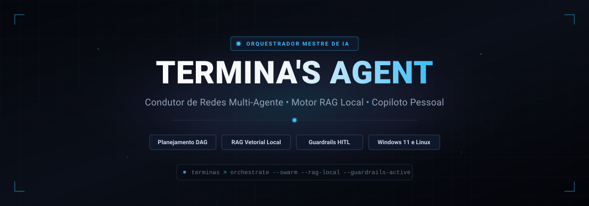

<p align="center">
  
</p>

<h1 align="center">Termina's Agent</h1>

<p align="center">
  <strong>O Agente Mestre para Copiloto Pessoal, Conhecimento Local (RAG) e Redes Multi-Agente.</strong>
</p>

<p align="center">
  <a href="LICENSE"></a>
  
  
  
  
</p>

---

## Visao Geral

O **Termina's Agent** e um agente autonomo mestre projetado para atuar como copiloto tecnico central e orquestrador de uma rede descentralizada de subagentes especialistas. O Termina decompoe metas amplas em grafos aciclicos dirigidos (DAGs), despacha tarefas de forma assincrona para agentes externos, fundamenta raciocinios em documentos locais via RAG sem custo de API e protege o ambiente operacional atraves de guardrails de seguranca *Human-in-the-Loop*.

Desenvolvido com foco no terminal, operacao local-first e compatibilidade multiplataforma nativa.

---

## Recursos Principais

- **Planejamento Deterministico em DAG:** Decompoe instrucoes de alto nivel em grafos de tarefas com dependencias explicitas e execucao concorrente de nos independentes.
- **Orquestracao Assincrona de Subagentes:** Despacha trabalhos para agentes especialistas externos e desacoplados atraves de um barramento tipado de mensagens JSON (A2A).
- **RAG Local de Documentos:** Ingestao de arquivos locais (`.pdf`, `.md`, `.txt`, codigo-fonte) utilizando embeddings locais em CPU e armazenamento vetorial SQLite, garantindo privacidade e custo zero.
- **Guardrails Human-in-the-Loop (HITL):** Intercepta comandos de shell de alto risco, exclusoes e operacoes criticas com solicitacao de confirmacao visual antes da execucao.
- **Memoria Multinivel:** Persiste contexto de trabalho, historico de sessoes ativas e regras permanentes do usuario em banco SQLite embutido.
- **Comportamento Pre-definido e Customizavel:** Persona tecnica pronta de fabrica com personalizacao direta via `config.yaml` ou comando `/behavior`.
- **Catalogo de 9 Skills Nativas:** Ferramentas embutidas prontas para fluxos de desenvolvimento, geracao de documentos, integracao Google Workspace, pesquisa web e conexao com servidores MCP.
- **Compatibilidade Nativa Multiplataforma:** Suporte de primeira classe para Windows 11 e distribuicoes Linux sem caminhos fixos ou dependencia de interpretadores exclusivos.

---

## Arquitetura

O Termina opera como o **nucleo inteligente central (Hub)**, enquanto os subagentes especialistas atuam como **modulos de execucao desacoplados (Spokes)**:

```text
                     ┌──────────────────────────────────┐
                     │     Interface de Terminal (TUI)  │
                     └─────────────────┬────────────────┘
                                       │
                                       ▼
┌──────────────────────────────────────────────────────────────────────────────┐
│                        Termina's Agent (Agente Mestre)                       │
│                                                                              │
│  ┌───────────────────────┐  ┌───────────────────────┐  ┌──────────────────┐  │
│  │   Motor de Planner    │  │       Motor RAG       │  │ Motor de Memoria │  │
│  │ (Decomposicao & DAG)  │  │  (Embeddings Locais)  │  │ (Persistencia DB)│  │
│  └───────────┬───────────┘  └───────────┬───────────┘  └────────┬─────────┘  │
│              │                          │                       │            │
│  ┌───────────▼──────────────────────────▼───────────────────────▼─────────┐  │
│  │                     Roteador e Despachador de Agentes                  │  │
│  └───────────────────────────────────┬────────────────────────────────────┘  │
│                                      │                                       │
│  ┌───────────────────────────────────▼────────────────────────────────────┐  │
│  │               Matriz de Seguranca HITL (Guardrails)                    │  │
│  └───────────────────────────────────┬────────────────────────────────────┘  │
└──────────────────────────────────────┼───────────────────────────────────────┘
                                       │ (Barramento Assincrono A2A JSON)
          ┌────────────────────────────┼────────────────────────────┐
          ▼                            ▼                            ▼
┌──────────────────┐         ┌──────────────────┐         ┌──────────────────┐
│ Subagente Dev    │         │ Subagente Pesq.  │         │ Subagente Custom │
│ (Externo / Plug) │         │ (Externo / Plug) │         │ (Externo / Plug) │
└──────────────────┘         └──────────────────┘         └──────────────────┘
```

---

## Catalogo de Skills Nativas

O sistema conta com 9 skills nativas de fabrica:

| Skill | Categoria | Descricao |
|---|---|---|
| `issue-flow` | Engenharia | Ciclo completo de issues no GitHub: criacao, quebra de tarefas, commits convencionais e abertura de PRs via `gh`. |
| `doc-gen` | Documentacao | Geracao e conversao de relatorios em PDF e DOCX, alem de diagramas tecnicos em SVG e Mermaid. |
| `google-workspace` | Produtividade | Integracao via MCP com Google Agenda (criacao e consulta de eventos), Gmail e Google Drive. |
| `deep-search` | Pesquisa | Pesquisa web aprofundada, raspagem de conteudo e sintese de especificacoes tecnicas. |
| `swarm-inspector` | Orquestracao | Monitoramento em tempo real de subagentes: telemetria de tokens, latencia e comandos de parada. |
| `daily-briefing` | Produtividade | Consolidacao da agenda diaria, issues prioritarias e pendencias salvas na memoria. |
| `rag-indexer` | Conhecimento | Fatiamento, indexacao vetorial e busca semantica sobre arquivos locais (`/rag`). |
| `shell-safe-runner` | Sistema | Execucao controlada de comandos de terminal com aprovacao previa via HITL para acoes de risco. |
| `quick-notes` | Memoria | Captura rapida de anotacoes e contexto sincronizados com a memoria persistente e vaults Markdown. |

---

## Inicio Rapido

### Instalacao

Um unico comando. Voce **nao precisa ter Python nem Git instalados**, e nada pede administrador ou `sudo`: o instalador usa o [`uv`](https://docs.astral.sh/uv/), que baixa o Python necessario e isola o Termina em um ambiente proprio.

#### Windows (PowerShell)
```powershell
irm https://raw.githubusercontent.com/guilhermetft/terminas-agent/main/install.ps1 | iex
```

#### Linux / macOS
```bash
curl -fsSL https://raw.githubusercontent.com/guilhermetft/terminas-agent/main/install.sh | bash
```

Quando terminar, abra um **novo terminal** e rode `terminas`. Os scripts sao curtos e legiveis: [`install.ps1`](install.ps1) e [`install.sh`](install.sh).

#### Atualizar
Rode o mesmo comando de instalacao de novo.

#### Desinstalar
```powershell
# Windows
$env:TERMINAS_UNINSTALL = '1'; irm https://raw.githubusercontent.com/guilhermetft/terminas-agent/main/install.ps1 | iex
```
```bash
# Linux / macOS
curl -fsSL https://raw.githubusercontent.com/guilhermetft/terminas-agent/main/install.sh | bash -s -- --uninstall
```
Seus dados (pasta `.terminas/`) nao sao apagados.

#### Opcoes
| Variavel | Efeito | Padrao |
|---|---|---|
| `TERMINAS_VERSION` | tag, branch ou commit a instalar | `main` |
| `TERMINAS_EXTRAS` | extras opcionais: `rag` (busca semantica local), `mcp` (ferramentas MCP) ou `none` | `rag,mcp` |
| `TERMINAS_PYTHON` | versao do Python usada pelo Termina | `3.12` |

```powershell
# Windows: instalar uma versao especifica, sem extras
$env:TERMINAS_VERSION = 'v1.0.0'; $env:TERMINAS_EXTRAS = 'none'; irm https://raw.githubusercontent.com/guilhermetft/terminas-agent/main/install.ps1 | iex
```
```bash
# Linux / macOS (a variavel vai antes do bash, depois do pipe)
curl -fsSL https://raw.githubusercontent.com/guilhermetft/terminas-agent/main/install.sh | TERMINAS_VERSION=v1.0.0 TERMINAS_EXTRAS=none bash
```

#### Instalacao para desenvolvimento
```bash
git clone https://github.com/guilhermetft/terminas-agent.git
cd terminas-agent
python -m venv .venv
source .venv/bin/activate        # Windows (PowerShell): .\.venv\Scripts\Activate.ps1
pip install -e ".[dev]"
```

---

## Modo de Uso

Inicializar a interface interativa no terminal:

```bash
terminas
```

Ou executar um objetivo direto via linha de comando:

```bash
terminas run "Indexar a pasta ./docs com RAG e resumir as regras de guardrail de seguranca"
```

### Comandos de Barra (Slash Commands)

Durante a sessao interativa, utilize os seguintes comandos:

- `/plan <meta>`: Gera e exibe o grafo DAG de tarefas sem iniciar a execucao.
- `/run <meta>`: Planeja e executa a orquestracao multi-agente imediatamente.
- `/rag index <caminho>`: Indexa arquivos ou diretorios locais na base vetorial.
- `/rag ask <pergunta>`: Consulta a base documental indexada com citacao de trechos.
- `/skills`: Lista todas as skills nativas registradas e servidores MCP conectados.
- `/status`: Exibe o estado dos subagentes ativos e consumo de tokens da sessao.
- `/behavior`: Consulta ou ajusta o prompt de sistema e tom do agente.
- `/clear`: Limpa a memoria de trabalho volatil e reinicializa a visualizacao.

---

## Documentacao do Projeto

A especificacao tecnica completa e os diagramas de projeto estao organizados no diretorio [`docs/`](docs/):

- [1 - Introducao](docs/1%20-%20Introducao.md): Contexto, definicao do problema e objetivos.
- [2 - Especificacao](docs/2%20-%20Especificacao.md): Personas, historias de usuario, requisitos funcionais e nao-funcionais.
- [3 - Arquitetura](docs/3%20-%20Arquitetura.md): Estrutura de modulos, barramento A2A, RAG, skills e organizacao de pastas.
- [4 - Plano de Testes](docs/4%20-%20Plano-testes-software.md): Estrategia de validacao e 9 casos de teste (CT-01 a CT-09).
- [5 - Registro de Testes](docs/5%20-%20Registro-testes-software.md): Matriz de rastreabilidade e controle de conformidade.
- [6 - Projeto de Interface](docs/6%20-%20Projeto-interface.md): Wireframes do terminal TUI, modais HITL e comandos operacionais.

---

## Licenca

Este projeto e distribuido sob os termos da [Licenca MIT](LICENSE).
