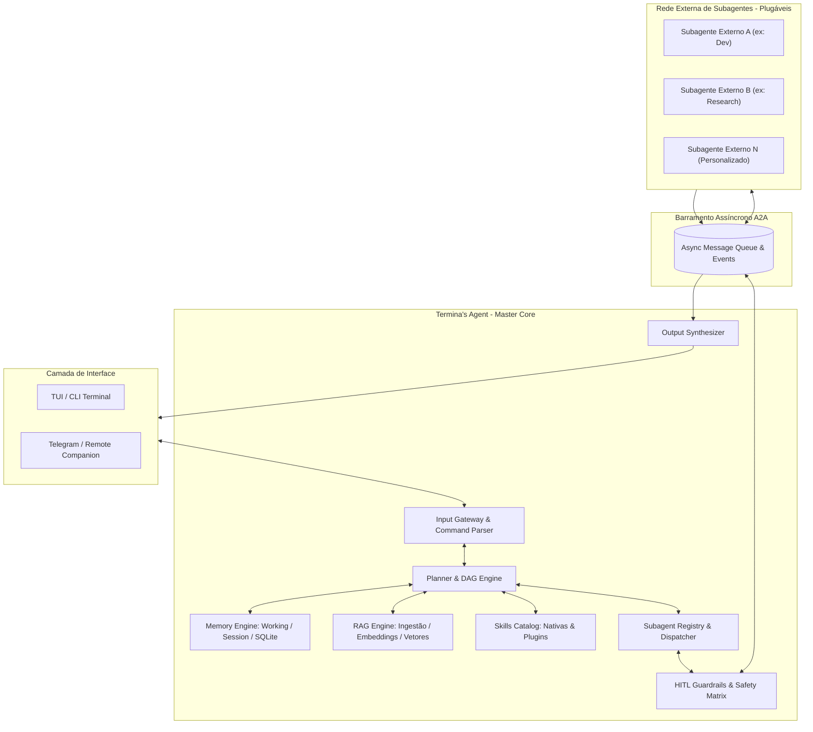

# 3. Arquitetura do Sistema — Termina's Agent

## 3.1 Visão Geral
A arquitetura do **Termina's Agent** segue o padrão **Hierárquico / Hub-and-Spoke**, onde o Termina atua exclusivamente como **Agente Mestre (Master Orchestrator / Host)**. O escopo imediato deste projeto foca integralmente na inteligência central, motor de planejamento, memória, RAG, catálogo de skills e interface. Os **subagentes especialistas são módulos externos desacoplados**, desenvolvidos separadamente pelo usuário e plugados na rede do Termina através de contratos e interfaces padronizadas.



---

## 3.2 Componentes Centrais do Termina's Agent

### 3.2.1 Input Gateway & Command Parser
- Processa entradas textuais e comandos de barra (`/cmd`).
- Roteia comandos operacionais (`/plan`, `/rag`, `/skills`, `/status`, `/behavior`) sem acionar LLM quando a resposta for puramente determinística.

### 3.2.2 Planner & DAG Engine
- Decompõe metas complexas em grafos acíclicos dirigidos (DAGs) de tarefas atômicas.
- Mapeia nós dependentes (sequenciais) e nós isolados (executados em paralelo de forma assíncrona).

### 3.2.3 Subagent Registry & Dispatcher
- Mantém o catálogo de subagentes externos cadastrados, registrando nome, capacidades, modelos recomendados e schemas de entrada.
- Despacha tarefas para o agente correto e gerencia timeouts, retentativas e cancelamentos.
- *Nota de Escopo:* O Termina fornece a interface abstrata (`BaseSubagent`) e o barramento. Os subagentes concretos são desenvolvidos e plugados de forma independente.

### 3.2.4 Memory Engine
Armazenamento local em quatro níveis:
1. **Working Memory:** Estado e variáveis da execução corrente (volátil).
2. **Short-Term Memory:** Histórico recente da sessão ativa (janela deslizante com compressão).
3. **Episodic Memory:** Registro de tarefas passadas, planos bem-sucedidos e métricas (persistido em SQLite).
4. **Long-Term Memory:** Regras do usuário, perfis de comportamento e diretrizes permanentes.

### 3.2.5 RAG Engine (Retrieval-Augmented Generation)
Subsistema responsável pela ingestão, indexação e busca contextual em arquivos do usuário:
- **Pipeline de Ingestão:** Carregadores de arquivos locais (`.pdf`, `.md`, `.txt`, `.py`, `.json`, etc.).
- **Chunking Semântico:** Divisão de textos em blocos com sobreposição configurável (*overlap*).
- **Embeddings Locais:** Geração de vetores semânticos via modelos rápidos locais (ex: `all-MiniLM-L6-v2` ou embeddings leves em CPU) para custo zero e privacidade.
- **Indexação & Busca:** Armazenamento vetorial local (SQLite com `sqlite-vec` ou DuckDB).
- **Injeção de Contexto:** Recupera os top-K trechos mais relevantes e os anexa ao prompt do Planner ou do Subagente com citação de arquivo e número de linha.

### 3.2.6 Catálogo de Skills Nativas e Plugins
Mecanismo unificado para execução de ferramentas pelo próprio Termina's Agent ou disponibilizadas sob demanda para seus subagentes externos:

| Categoria | Identificador da Skill | Finalidade & Capacidades |
|---|---|---|
| **Engenharia & Git** | `issue-flow` | Automação de ciclo de vida no GitHub: criação de issues, desmembramento em tarefas, commits convencionais e abertura de Pull Requests via `gh CLI`. |
| **Documentação & Mídia** | `doc-gen` | Geração e conversão de relatórios profissionais em PDF e DOCX, além de renderização de imagens e diagramas (Mermaid/SVG). |
| **Integração Google / MCP** | `google-workspace` | Conexão MCP com Google Calendar/Agenda (criação e consulta de eventos), leitura de emails do Gmail e documentos do Drive. |
| **Pesquisa & Web** | `deep-search` | Busca na web com busca profunda, raspagem inteligente de conteúdo e síntese de documentações técnicas. |
| **Orquestração de Agentes** | `swarm-inspector` | Diagnóstico em tempo real da rede de subagentes externos: inspeção de saúde, tempos de resposta, consumo de tokens e comandos de kill/restart. |
| **Rotina & Produtividade** | `daily-briefing` | Consolidação matinal/noturna de compromissos (Google Agenda) + issues prioritárias + pendências gravadas na memória. |
| **Conhecimento Local** | `rag-indexer` | Ingestão, fatiamento (*chunking*), indexação vetorial e consulta semântica em arquivos locais (`/rag index` e `/rag ask`). |
| **Operação de Sistema** | `shell-safe-runner` | Execução controlada de comandos de terminal (build, testes, git) com interceptação obrigatória pelo guardrail HITL antes de ações críticas. |
| **Memória & Notas** | `quick-notes` | Captura imediata de ideias, notas soltas e decisões com armazenamento na memória de longo prazo e sincronização com vaults Markdown/Obsidian. |

- **Plugin & MCP Loader:** Além das 9 skills nativas de fábrica, o sistema suporta descoberta dinâmica de skills em `src/skills/plugins/` e conexão com servidores externos via MCP (*Model Context Protocol*).

### 3.2.7 HITL Guardrails (Human-in-the-Loop)
- Analisa ações de ferramentas contra regras de segurança antes da execução.
- Bloqueia comandos de risco (exclusão de pastas, escrita destrutiva, comandos shell perigosos) e renderiza prompt de confirmação no terminal (`[Y/n]`).

### 3.2.8 Output Synthesizer
- Recebe os dados de retorno de múltiplos nós do plano, agrega os resultados e gera uma resposta única, coesa e técnica no terminal, ocultando ruídos operacionais intermediários.

---

## 3.3 Protocolo de Comunicação Agente-Agente (A2A)

A comunicação entre o Termina e os subagentes externos segue contratos JSON tipados:

### 3.3.1 Payload de Despacho (Master -> Subagent Externo)
```json
{
  "$schema": "https://terminas.dev/schemas/a2a-task.json",
  "task_id": "tsk-42a1b9",
  "parent_task_id": null,
  "assigned_agent": "dev-agent",
  "goal": "Executar testes unitários e gerar relatório de cobertura",
  "context": {
    "project_path": "/home/user/project",
    "relevant_rag_chunks": [
      { "file": "README.md", "lines": "10-25", "content": "..." }
    ]
  },
  "constraints": {
    "max_steps": 10,
    "timeout_seconds": 120,
    "allowed_skills": ["fs_tools", "shell_runner"]
  }
}
```

### 3.3.2 Payload de Retorno (Subagent Externo -> Master)
```json
{
  "$schema": "https://terminas.dev/schemas/a2a-result.json",
  "task_id": "tsk-42a1b9",
  "status": "success",
  "summary": "14 testes executados, 14 passaram. Cobertura: 92%.",
  "artifacts": [
    { "type": "coverage-report", "path": "coverage/report.json" }
  ],
  "token_usage": {
    "prompt_tokens": 1240,
    "completion_tokens": 195,
    "model": "gemini-2.5-flash"
  },
  "error": null
}
```

---

## 3.4 Tecnologias e Dependências

| Camada | Tecnologia / Biblioteca | Função |
|---|---|---|
| **Linguagem** | Python 3.11+ | Execução assíncrona (`asyncio`), compatibilidade total Windows & Linux. |
| **Orquestração & Schemas** | Pydantic / Pydantic-AI | Modelagem estrita de tipos, contratos A2A e validação em runtime. |
| **Abstração de LLM** | LiteLLM | Conexão unificada com APIs (Claude, Gemini, OpenAI) e modelos locais (Ollama). |
| **RAG & Embeddings** | FastEmbed / Sentence-Transformers | Embeddings locais em CPU, rápidos e sem custo de token. |
| **Persistência Vetorial & Memória** | SQLite + sqlite-vec | Banco leve em arquivo local único, sem dependência de containers ou nuvem. |
| **Interface do Terminal** | Rich / Textual | Renderização de TUI, tabelas de progresso e modais de confirmação. |
| **Protocolo de Ferramentas** | Model Context Protocol (MCP) SDK | Conexão com ferramentas externas padronizadas. |

---

## 3.5 Estrutura de Diretórios do Termina's Agent

Focada estritamente no núcleo do Master Agent, deixando os subagentes como entidades externas plugáveis:

```text
terminas-agent/
├── docs/                      # Documentação completa do projeto
│   ├── 1 - Introducao.md
│   ├── 2 - Especificacao.md
│   ├── 3 - Arquitetura.md
│   ├── 4 - Plano-testes-software.md
│   ├── 5 - Registro-testes-software.md
│   └── 6 - Projeto-interface.md
├── src/
│   ├── core/                  # Núcleo do Master Agent
│   │   ├── engine.py          # Ciclo de vida e orquestrador
│   │   ├── planner.py         # Decompositor de metas e gerador de DAG
│   │   ├── dispatcher.py      # Barramento e despacho A2A
│   │   └── guardrails.py      # Matriz de segurança e aprovação HITL
│   ├── rag/                   # Subsistema de RAG Documental
│   │   ├── ingestion.py       # Leitura e parsing de arquivos (PDF, MD, etc.)
│   │   ├── chunking.py        # Fatiamento semântico
│   │   ├── embeddings.py      # Gerador de embeddings locais
│   │   └── vector_store.py    # Persistência vetorial em SQLite
│   ├── skills/                # Catálogo de Skills do Agente
│   │   ├── registry.py        # Registro e carregador de plugins
│   │   ├── native/            # Skills de fábrica (fs, web, docs, code)
│   │   └── mcp_client.py      # Conector de ferramentas via MCP
│   ├── memory/                # Subsistema de Memória e Perfil
│   │   ├── store.py           # Conexão SQLite (sessões e episódico)
│   │   └── config.py          # Configurações de comportamento (config.yaml)
│   ├── subagents_bridge/      # Contratos para subagentes externos
│   │   ├── base.py            # Classe abstrata BaseSubagent
│   │   ├── registry.py        # Registro e catálogo de agentes plugáveis
│   │   └── schemas.py         # Schemas Pydantic do protocolo A2A
│   ├── ui/                    # Interfaces com usuário
│   │   ├── cli.py             # Parser de comandos e terminal TUI
│   │   └── components/        # Componentes Rich (DAG view, modais)
│   └── main.py                # Ponto de entrada da aplicação
├── tests/                     # Bateria de testes automatizados
│   ├── unit/                  # Testes de módulos isolados
│   └── integration/           # Testes do fluxo mestre e RAG
├── config.example.yaml        # Exemplo de configuração de comportamento
├── pyproject.toml             # Metadados e dependências Python
├── LICENSE                    # Licença MIT
└── README.md                  # Apresentação do projeto
```
